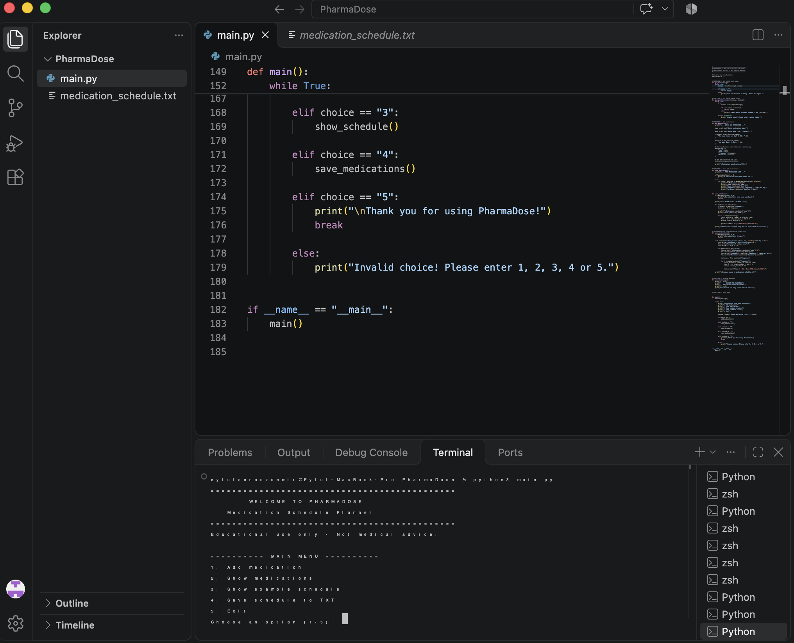
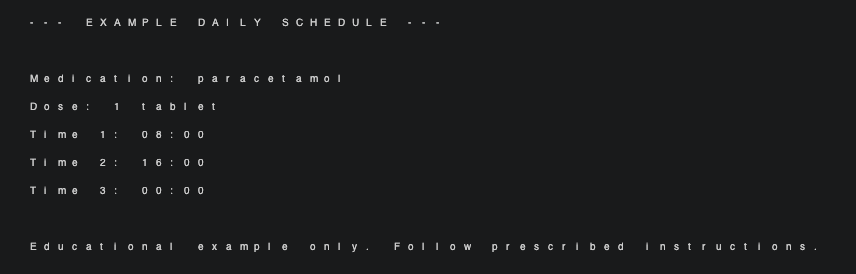
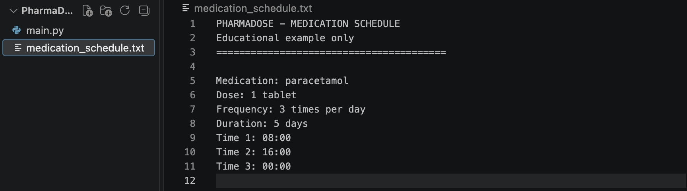

# PharmaDose – İlaç Kullanım Takvimi Planlayıcısı

## 1. Proje Hakkında

**PharmaDose**, GEP1316 Kodlama Okuryazarlığı dersi kapsamında Python programlama dili kullanılarak geliştirilmiş, komut satırı üzerinden çalışan bir ilaç kullanım takvimi planlama uygulamasıdır.

Projenin temel amacı, kullanıcıların ilaç bilgilerini düzenli bir şekilde kaydetmelerini, günlük kullanım sıklıklarına göre matematiksel örnek saatler oluşturmalarını ve bu bilgileri bir metin dosyasına aktarmalarını sağlamaktır.

Uygulama, eczacılık alanıyla ilişkili basit bir problemin temel programlama yöntemleri kullanılarak nasıl çözülebileceğini göstermeyi amaçlamaktadır.

**Önemli Uyarı:** PharmaDose yalnızca eğitim amacıyla geliştirilmiştir. Tıbbi tavsiye sunmaz, hastaya özel doz belirlemez ve gerçek ilaç kullanım saatleri için kullanılmamalıdır. İlaç kullanımı konusunda hekim ve eczacı tarafından verilen talimatlar esas alınmalıdır.

## 2. Uygulamanın Özellikleri

- İlaç adı ve doz bilgisinin kullanıcı tarafından girilmesi.
- Günlük kullanım sıklığı ve tedavi süresinin belirlenmesi.
- Eklenen ilaçların liste halinde görüntülenmesi.
- Günlük kullanım sıklığına göre eşit zaman aralıklarıyla örnek saatlerin hesaplanması.
- Hatalı kullanıcı girişlerinin kontrol edilmesi.
- İlaç bilgilerinin ve oluşturulan örnek takvimin TXT formatında kaydedilmesi.
- Kullanıcı dostu, menü tabanlı bir komut satırı arayüzü sunulması.

## 3. Kullanılan Teknolojiler

- **Python 3:** Uygulamanın geliştirilmesinde kullanılan programlama dili.
- **Visual Studio Code:** Kod yazma, düzenleme ve test işlemleri için kullanılan geliştirme ortamı.
- **GitHub:** Proje dosyalarının saklanması, düzenlenmesi ve paylaşılması için kullanılan platform.

## 4. Kurulum ve Çalıştırma

Uygulamayı çalıştırmak için aşağıdaki adımlar izlenmelidir:

1. Bilgisayara Python 3 yüklenir.
2. GitHub deposundaki `main.py` dosyası indirilir.
3. Terminal açılarak dosyanın bulunduğu klasöre geçilir.
4. Aşağıdaki komut çalıştırılır:

```bash
python3 main.py
```

5. Ekranda görüntülenen ana menü üzerinden istenilen işlem seçilir.

Uygulama için ek bir Python kütüphanesinin yüklenmesi gerekmemektedir.

## 5. Uygulamanın Ana Menüsü

Program çalıştırıldığında kullanıcıya beş farklı işlem seçeneği sunulur:

| Seçenek | İşlev |
|---|---|
| 1 | Yeni ilaç bilgisi ekleme |
| 2 | Kaydedilen ilaçları görüntüleme |
| 3 | Örnek ilaç kullanım takvimini görüntüleme |
| 4 | İlaç bilgilerini ve takvimi TXT dosyasına kaydetme |
| 5 | Programdan çıkış yapma |

## 6. Örnek Kullanım

Kullanıcı tarafından aşağıdaki örnek bilgiler girilebilir:

| Bilgi | Örnek Değer |
|---|---|
| İlaç adı | Paracetamol |
| Doz bilgisi | 1 tablet |
| Günlük kullanım sıklığı | 3 |
| Tedavi süresi | 5 gün |

Bu bilgiler doğrultusunda program, başlangıç saatini 08.00 kabul ederek eşit zaman aralıklarına dayalı aşağıdaki örnek saatleri oluşturur:

**08:00 – 16:00 – 00:00**

Bu saatler yalnızca matematiksel hesaplamayı göstermek amacıyla oluşturulmuştur. Gerçek bir ilaç kullanım önerisi değildir.

## 7. Kullanılan Python Programlama Kavramları

Projenin geliştirilmesi sırasında aşağıdaki temel programlama kavramlarından yararlanılmıştır:

- **Fonksiyonlar:** Programın farklı görevlerinin ayrı bölümler halinde düzenlenmesi.
- **Listeler ve sözlükler:** İlaç bilgilerinin saklanması ve yönetilmesi.
- **Koşullu ifadeler (`if`, `elif`, `else`):** Menü seçimlerinin ve kullanıcı girişlerinin değerlendirilmesi.
- **Döngüler (`while`, `for`):** Programın çalışmaya devam etmesi ve kayıtların işlenmesi.
- **Girdi doğrulama:** Kullanıcı tarafından girilen bilgilerin kontrol edilmesi.
- **Hata yönetimi (`try`, `except`):** Uygun olmayan veri girişlerinden kaynaklanabilecek hataların ele alınması.
- **Dosya işlemleri:** Bilgilerin `.txt` uzantılı bir dosyaya kaydedilmesi.

## 8. Ekran Görüntüleri

### 8.1. Uygulamanın Ana Menüsü



### 8.2. Örnek İlaç Kullanım Takvimi



### 8.3. TXT Dosyasına Kaydedilen Çıktı



## 9. Test Senaryoları

Uygulamanın temel işlevlerini ve hata kontrol mekanizmalarını değerlendirmek amacıyla aşağıdaki senaryolar test edilmiştir:

| Test | Senaryo | Beklenen Sonuç |
|---|---|---|
| 1 | Geçerli ilaç bilgilerinin girilmesi | İlaç kaydının başarıyla oluşturulması |
| 2 | Kaydedilen ilaçların listelenmesi | İlaç bilgilerinin ekranda görüntülenmesi |
| 3 | Günlük kullanım sıklığına harf (`abc`) girilmesi | Hatalı girişin tespit edilmesi |
| 4 | Günlük kullanım sıklığına `0` girilmesi | Geçersiz değerin reddedilmesi |
| 5 | Günlük kullanım sıklığının `3` olarak belirlenmesi | Örnek saatlerin hesaplanması |
| 6 | TXT dosyasına kayıt seçeneğinin kullanılması | Metin dosyasının oluşturulması |
| 7 | Menüde bulunmayan `9` seçeneğinin girilmesi | Geçersiz menü seçiminin bildirilmesi |

## 10. Yapay Zekâ Kullanımı

Projenin geliştirilme sürecinde ChatGPT'den programlama kavramlarını öğrenmek, örnek kod yapılarını değerlendirmek, hata mesajlarını anlamak ve test senaryolarını planlamak amacıyla destek alınmıştır.

Yapay zekâ tarafından sunulan öneriler geliştirme sürecinde incelenmiş, gerekli düzenlemeler yapılmış ve uygulama test edilmiştir.

Yapay zekâ ile gerçekleştirilen etkileşimlerin ve değerlendirmelerin ayrıntıları `PROMPTLAR.md` dosyasında açıklanmıştır.

## 11. Projenin Amacı ve Kazanımları

PharmaDose projesi, eczacılık eğitimiyle ilişkili bir örnek üzerinden temel Python programlama becerilerinin uygulanmasını amaçlamaktadır.

Proje sayesinde kullanıcıdan veri alma, verileri saklama, koşullu ifadeler ve döngüler kullanma, fonksiyon oluşturma, hata kontrolü gerçekleştirme ve dosyaya veri kaydetme konularında uygulamalı deneyim kazanılmıştır.

Ayrıca yazılım geliştirme sürecinde yapay zekâ araçlarından eleştirel ve sorumlu biçimde yararlanmanın önemi değerlendirilmiştir.

---

**Ders:** GEP1316 – Kodlama Okuryazarlığı

**Proje:** PharmaDose – İlaç Kullanım Takvimi Planlayıcısı

**Proje Türü:** Python Mini Uygulaması

**Geliştirme Amacı:** Eğitim ve programlama becerilerinin geliştirilmesi
